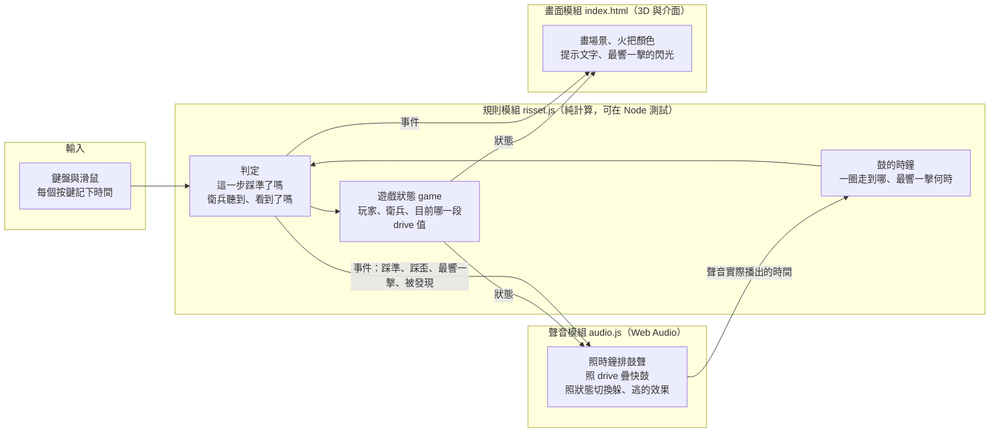
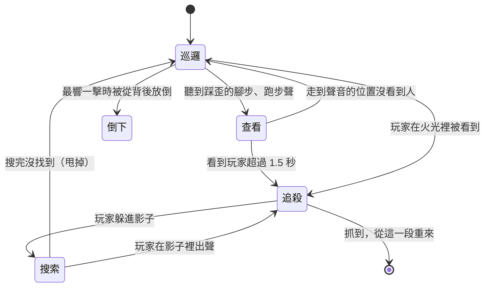

# 《木馬之夜》期末版企劃書（2026-11-15，設計席）

狀態：🟡 初稿，等試玩清單頁的四項結果（照亮場景整關、敲暗號、弓弦、空白鍵與 Alt）回來補第 4 節；其餘可以當第 12 週提案的底稿。
一句話結論：做一個 8～10 分鐘、七段的潛行關卡，玩家踩著鼓點從木馬走到城門；鼓聲從頭到尾越來越急（`DRIVE`），這一項確定進遊戲，只動聲音。
依據：`2026-11-12-free-hit-schedule.md` 第 13 節、`2026-11-11-companion-mechanics.md`、`2026-11-11-trojan-horse-directions.md`、`2026-11-15-hit-reveal-spec.md`、`docs/process/playtest-notes.md`（11/15 試聽）、`docs/process/status-board.md` 期末段。

專有詞（第一次出現都在這裡）：
- **踩拍**＝腳步落在鼓點上，腳步聲就被鼓聲蓋住，衛兵聽不到。
- **最響的一擊**＝所有鼓同時落下、特別重的那一下，之後 0.6 秒衛兵察覺不到你，可以衝刺、從背後放倒衛兵。
- **一圈**＝鼓聲從一次最響的一擊到下一次，遊戲裡大約 5～6.5 秒。
- **催促（`DRIVE`）**＝一個 0 到 1 的數字，越大，鼓聲上面疊的快鼓越多、越大聲；只影響聽起來多急，不影響哪幾拍踩得上。
- **查看**＝衛兵聽到怪聲，走過來看一下（火把變橘色）；退開或躲進影子就沒事。
- **追殺**＝衛兵看到你了（火把變紅），要跑、要躲進影子等他搜完。
- **關口**＝一段路上一定要通過、最考時機的那個點。
- **程式玩家**＝自動玩遊戲的程式，用來量通關率與時間。

---

## 1. 概念與核心循環

**一句話**：特洛伊城慶祝勝利的那一夜，你是從木馬肚子裡爬出來的奧德修斯；全城的祭典鼓聲是你唯一的掩護，踩著鼓點走到城門、把門打開。【經典】

**玩家每幾秒在做的事**

1. **聽**：找出鼓聲裡踩得上的低鼓，以及下一次最響的一擊什麼時候來。
2. **踩**：跟著低鼓走，腳步聲被蓋住；踩歪一步，衛兵就會過來查看。
3. **等那一擊**：最響的一擊落下的 0.6 秒裡做大動作，衝過火光、從背後放倒衛兵。
4. **越來越急**：鼓聲隨著你深入城裡越來越密、越來越快，逼你在更吵、更急的聲音裡找到同一條低鼓。

**特色（提案時講這三點）**
- 用耳朵玩的潛行：安全不安全是聽出來的。
- 鼓聲用「聽起來一直在加速」的節奏錯覺（Risset 節奏）做底，再加上真的越疊越快的鼓，整關是一條往上的緊張曲線。
- 經典故事，沒讀過也懂：木馬、夜裡、開城門。

## 2. 關卡流程（首次遊玩含重來 8～10 分鐘）

現行原型是四區（木馬腹中與木馬下、神殿廣場、窄巷、城門），程式玩家（中等準度）跑完約 45 秒；真人時間沒量過，第 13 週小組測試時量。下表的時長是目標，不是量到的數字。

| 段 | 名稱 | 目標時長 | 教什麼（每段只教一件新事） | 難度 | `DRIVE` 起→止 | 來源 |
|---|---|---|---|---|---|---|
| 序 | 木馬進城 | 0:30 | 不能操作。三張插圖加旁白：木馬被拖進城、全城慶祝、夜深 | — | 鼓聲隔著木板，悶 | 【經典】 |
| 1 | 木馬腹中 | 1:00 | 踩拍：在肚子裡踩準 4 步，暗門才開；不會失敗 | 0 | 0.30→0.35 | 【經典】＋【改編】 |
| 2 | 木馬下 | 0:40 | 最響的一擊：等那一擊落下，從木馬的影子走出去；一名衛兵 | 1 | 0.35→0.45 | 【改編】 |
| 3 | 神殿廣場 | 1:20 | 影子與查看：踩歪了衛兵會走過來，退開或躲進影子 | 2 | 0.45→0.60 | 【改編】 |
| 4 | 慶宴的街【新】 | 1:20 | 蹲與跑：開闊、矮掩體多，蹲著過矮牆、跑過沒人的空地 | 2 | 0.60→0.70 | 【經典】（特洛伊人慶祝到醉倒）＋【改編】 |
| 5 | 城牆下的窄巷（重排） | 1:10 | 從背後放倒衛兵、屏息 | 3 | 0.70→0.80 | 【改編】 |
| 6 | 沒有火的後街【新】 | 1:20 | 追殺與甩掉；整關最暗，靠最響的一擊照亮看路（照亮場景納入時） | 4 | 0.80→0.90 | 【改編】 |
| 7 | 城門 | 1:10 | 綜合；推門閂要挑時機 | 4 | 0.90→1.00 | 【經典】 |
| 終 | 城門開了 | 0:30 | 不能操作。一張插圖：城門打開、城外的火把 | — | 最後一擊後全靜 | 【經典】 |

合計 9:00。熟手不重來大約 5 分鐘（推測）。

**難度曲線的做法**
- 每段**只有一個關口**，其餘是可以喘氣的路。現行第 3 區窄巷的問題是整段都是關口：巷尾兩名衛兵交錯，被追殺後最難甩掉的就是這一段（量測與判讀見 `2026-11-11-companion-mechanics.md` 第 14～17 節）。
- 前兩段不會被追殺（腹中不會失敗；木馬下的衛兵只會查看）。追殺第一次出現在廣場，正式教在後街。
- 畫面提示照現有的輔助分區往後減少：第 1～4 段完整、第 5 段變淡、第 6～7 段沒有。

**窄巷重排（給建築同學的規格，其他新區照同一套）**

| 項目 | 規定 | 理由 |
|---|---|---|
| 關口 | 每段一個，寬 3～4 公尺 | 整段都窄就沒有退路 |
| 影子 | 每段至少 3 塊，關口前後各一塊，最遠相隔不超過 10 公尺 | 被追殺時 3 秒內跑得到 |
| 矮掩體 | 新區各 3 個以上；窄巷補 2 個 | 蹲才有用處 |
| 衛兵 | 每段最多 3 名；同一個關口最多 1 名巡邏加 1 名站崗 | 兩名巡邏交錯目前沒人過得去 |
| 空地 | 每段一塊 8 公尺以上、沒有衛兵聽得到的路段 | 讓跑有用、讓玩家喘氣 |
| 存檔點 | 每段起點，起點在影子裡 | 重來不會一出生就被看到 |
| 大小 | 新區各約 15 × 30 公尺，全圖從 60 × 30 加長到約 90 × 30 | 一段要走 1 分多鐘；實際大小第 13 週量過再調 |

交付：方格紙一格 1 公尺，標牆、矮掩體、影子、衛兵路線與面向、起點、出口。由程式抄成關卡資料。

## 3. `DRIVE` 進遊戲的裁決（原 13.4 第 3 步）

🟢 **進遊戲。** 依據是 11/15 試聽：H2（`DRIVE` 1）才夠快、H3 連續升有累積感、低鼓與最響的一擊在 H2 都聽得清。

| 項目 | 裁決 | 依據／備註 |
|---|---|---|
| 升法 | **連續升**，不分階 | H3 勝過 H4 |
| 範圍 | **0.30 到 1.00**。起點不放 0 | H1（0.5）還不夠快，從 0 起會有半關聽起來太慢。0.30 是假設，要聽 |
| 每段的值 | 第 2 節表格的「起→止」；在該段裡照經過的時間直線升，花該段目標時長的 1.5 倍升到「止」，到了就停 | 待在原地也會升，但有上限，不會在第 2 段就到頂 |
| 換段 | 進下一段時，若低於該段的「起」，4 秒內滑上去；不跳 | 不要聽到一階一階 |
| 追殺 | 2 秒內升到 1.00（沿用現有的逃跑加速）；甩掉後 4 秒內滑回追殺前的值 | 只有這裡和重來會往下 |
| 重來 | 回到該段的「起」 | 存檔點是每段起點 |
| 躲在影子裡 | 現有的悶住效果照樣疊上去 | 不改 |
| 誰算 | 規則檔新增純函式 `driveFor(段, 該段經過秒數, 是否追殺中, 追殺前的值)`，結果放 `game.drive`；**任何判定都不讀它**。聲音讀它決定快鼓的音量，畫面可以讀它做氣氛 | 放在規則檔才測得到；不讀它才不會改難度 |
| 第三步（把最響的一擊解開） | ⚪ 不進期末版 | 見下 |

> [!WARNING]
> 「速度上去後還聽不聽得出又從頭來了」使用者答「每個不一樣」，這題沒有結論。不擋 `DRIVE` 進遊戲；進遊戲後的第一次試玩補問一題：「第 6、7 段（最快的時候）聽不聽得出鼓聲在重來？」聽得出而且礙事，才重開第三步。
> 另外，長時間停在 1.00（每分鐘約 1100 拍的密鼓）耳朵會不會累，沒有人聽過超過 1 分鐘。所以只有城門和追殺會到頂。

**驗收（聲音角色做、量測角色驗）**
1. `DRIVE` 開關關掉時，聲音輸出和現在逐拍相同。
2. 全套測試與整關數字不變（規則沒有讀 `game.drive`）。
3. 任何 `DRIVE` 值下，踩得上的低鼓不小於最明顯那條鼓的 0.4 倍（現有檢查）。
4. `driveFor` 的 Node 測試：只增不減（追殺結束與重來除外）、換段不跳、追殺 2 秒到頂。
5. 試驗場：`?lab=drive`，畫面顯示目前的值，可以用按鍵直接設值與切換段。

## 4. 機制清單

**納入（期末版一定有）**

| 機制 | 現況 | 期末前要做的 |
|---|---|---|
| 踩拍走路 | 🟢 已做 | — |
| 最響的一擊（0.6 秒掩護） | 🟢 已做，±5 毫秒自動檢查 | — |
| 影子躲藏、查看、追殺與甩掉 | 🟢 已做 | 新區的搜索路線 |
| 跑與衝刺、蹲、屏息 | 🟢 已做；空白鍵立刻停、Alt 蹲 🔵 等清單頁 | 依試玩結果微調按鍵 |
| 從背後放倒衛兵、推門閂 | 🟢 已做 | — |
| 腹中練習（踩準 4 步開暗門） | 🟢 已做，在開關後面 | 改成預設開 |
| `DRIVE` 鼓聲越來越急 | 🟢 試聽通過 | 進遊戲（第 3 節） |
| 提示與輔助分區 | 🟢 已做 | 配合七段重排 |
| 序與終的插圖 | 沒有 | 電繪同學畫，程式做翻頁 |

**看試玩結果決定（預設值寫在右欄，結果回來我補裁決）**

| 機制 | 試玩到哪 | 預設 |
|---|---|---|
| 最響的一擊照亮場景（`REVEAL_MODE`） | 試驗場：好玩、暗度可接受；🔵 整關版等清單頁 | **納入，但只在第 6 段後街**當那一段的主題；整關結果好再擴到全關 |
| 敲暗號 | 第一次試「不知道怎麼敲」；改過說明，🔵 重試中 | **只留在腹中**：出暗門前照同伴的示範敲一次，當儀式，不做成整關指揮同伴。重試還是不會敲就砍 |
| 弓弦聲 | 🔵 待試 | **不納入**。弓是後面復仇那一章的東西，期末版不需要它 |

**不納入（寒假再說）**

| 機制 | 為什麼 |
|---|---|
| 第三步：最響的一擊不固定在一圈開頭 | 會改難度，要重量所有數字；`DRIVE` 夠用就不必做 |
| 整關一圈真的變短 | 同上 |
| 換層走路、一步一按 | 試玩結論是「只想在某些時候」，還沒有設計 |
| 離鼓越近越能動、自己補一拍 | 第二批想法，沒有原型 |
| 安撫 | 11/11 已拿掉，改成查看 |
| 手機版、電腦安裝版 | 使用者已定期末前只做網頁 |

## 5. 操作表（電腦，鍵盤加滑鼠）

| 按鍵 | 動作 | 備註 |
|---|---|---|
| W A S D（或方向鍵） | 走 | 起步落在低鼓上才算踩準 |
| 滑鼠 | 轉頭 | 點畫面鎖定滑鼠，Esc 放開 |
| Shift 點一下 | 衝刺一小段 | 最響的一擊後才安全 |
| Shift 按住 | 跑 | 很吵，跑完會喘 |
| Alt 按住 | 蹲 | 慢、安靜、能躲在矮掩體後 |
| 空白鍵 按住 | 立刻停下、屏住呼吸 | 聽得到衛兵腳步在哪 |
| E | 從背後放倒衛兵；城門前按住推門閂 | |
| T | 敲暗號 | 只在腹中，納入時才有 |
| R | 失敗後從這一段重來 | |
| Esc | 暫停 | |

Q 原本是安撫，已拿掉，空著。手把與手機觸控期末版不做。

## 6. 聲音方向

- **鼓**：一種鼓、六層、每層快一倍，音量照鐘形分布（試聽 U1 版）。底下一條低而厚的鼓是踩得上的拍，上面是 `DRIVE` 疊上去的快鼓。
- **最響的一擊**：每圈一次，落下前有預告音。
- **四種狀態的聲音**：潛行（正常）、躲（悶住、小聲 10 分貝）、逃（2 秒內加速到最快、帶殘響）、甩掉（滑回原本的值）。
- **衛兵**：腳步、追殺時的喊聲；屏息時聽得到位置。
- **序與終**：序的鼓聲隔著木板；終在城門打開的那一擊之後全部靜下來，只留風聲。
- **不做**：旋律配樂。整關的音樂就是鼓。
- 🔵 還要用耳朵確認：起點 0.30 會不會太慢、在最高值待 1 分鐘累不累、最快時聽不聽得出重來。

## 7. 美術方向

| 部分 | 風格 | 誰做 |
|---|---|---|
| 序與終的故事插圖（4 張）、角色立繪、標題字、介面圖示、海報 | **二次元畫風**，氣氛陰暗緊張；用色限三種：夜藍、火橘、警告紅 | 電繪同學 |
| 3D 遊戲畫面 | **暗色寫實**，維持現狀；光源只有火盆、火把 | 程式 |
| 兩者怎麼接 | 插圖的火橘與紅，和遊戲裡火把查看（橘）、追殺（紅）用同一組顏色；介面圖示用插圖的線條風格 | 一起定色票 |

**角色（名字加一個特徵稱號，沒讀過也記得住）**

| 稱呼 | 是誰 | 出現在 | 來源 |
|---|---|---|---|
| 多謀的奧德修斯 | 玩家 | 立繪、序 | 【經典】 |
| 腹中的同伴 | 木馬裡教你敲暗號、提醒別出聲的人；名字沿用木馬定稿文件 | 腹中的台詞、立繪 1 張 | 【改編】 |
| 舉火把的衛兵 | 特洛伊守夜人，不取名字 | 3D、插圖 | 【改編】 |

冷門人物不放進玩法；要放也只當一句台詞。畫面不出現現代的東西。

**提案要交的草圖**：風格草圖 2～3 張（電繪）、主視覺 1 張（電繪）、全城平面圖含新兩區（建築）、一張畫面截圖標出介面位置（程式）。

## 8. 三人分工與里程碑

日期：每週四上課（使用者 11/15 確認）——第 11 週 11/19、第 12 週提案 11/26、第 13 週 12/3、第 14 週 12/10、第 15 週 12/17、第 16 週期末發表 12/24。

| 週（約） | 使用者（設計、程式、整合） | 電繪同學 | 建築同學 | 這一週結束要看得到的東西 |
|---|---|---|---|---|
| 11（11/16～22） | `DRIVE` 進遊戲；腹中練習改預設；窄巷照新平面重排 | 分析 2～3 款遊戲的畫風，畫風格草圖 2～3 張 | 窄巷重排與新兩區的平面草圖（照第 2 節規格） | 玩得到會越來越急的四區版 |
| 12（11/23～29）**提案** | 概念（本文件第 1 節）、程式流程圖（第 9 節）、操作影片 1 分鐘 | 主視覺、序的插圖草稿 | 全城平面圖定稿 | 提案簡報 |
| 13（11/30～12/6）**小組測試** | 新兩區做進遊戲、序與終的翻頁、介面換圖 | 介面圖示、序與終的插圖完稿 | 主持試玩 3～5 人，記錄每段花多久、卡在哪 | 七段從頭玩到尾 |
| 14（12/7～13） | 照測試結果改難度與提示 | 角色立繪、標題 | 整理測試結果成一頁表 | 改過的版本與一頁測試結果 |
| 15（12/14～20） | 只修錯，不加東西；錄示範影片 | 發表簡報的版面、海報 | 發表問答準備、每週報告彙整 | 可以發表的版本 |
| 16（12/21～27）**發表** | 發表、現場示範 | 海報 | 示範時操作或解說關卡 | — |

**給組員的白話版**
- 這是一個用耳朵玩的潛行遊戲，在瀏覽器開網址就能玩，不用安裝。
- 電繪同學的圖是玩家最先看到的東西（標題、開場故事、海報）。交 PNG 到共用雲端資料夾，尺寸與檔名我會給清單。
- 建築同學畫的平面圖會直接變成關卡。畫在方格紙上拍照就可以，一格 1 公尺。
- 每週一有自動產生的週報底稿，建築同學補上這週三個人各做了什麼。

## 9. 程式流程

程式分三個模組，規則不知道聲音和畫面的存在，所以換畫面或換平台不用重寫規則。

- **時間以聲音為準**：鼓聲由瀏覽器的聲音系統精準排程，規則的時鐘跟著它走；按鍵的時間先扣掉聲音輸出的延遲再判定，所以聽到的拍和判定的拍是同一拍。
- **測試**：規則有 Node 測試與程式玩家（量通關率、時間）；聲音有自動檢查（最響的一擊誤差 ±5 毫秒內）；每個機制有自己的試驗場（網址參數開啟）。

**衛兵的狀態（玩家要對付的就是這張圖）**

## 10. 風險與砍範圍的順序

| 風險 | 多可能 | 對策 |
|---|---|---|
| 真人玩不到 8 分鐘（關卡太短或太簡單） | 中 | 第 13 週量；不夠就把後街加長，不加新機制 |
| `DRIVE` 進遊戲後還是沒有加速感 | 低到中（試聽頁通過，遊戲裡沒聽過） | 第 11 週就做進去，使用者第一時間聽；不行再把起點與每段的值拉開 |
| 新兩區做不完 | 中 | 照下面的順序砍 |
| 美術圖來不及或風格接不上 | 中 | 第 11 週先定色票與尺寸清單；插圖沒到就用文字旁白加黑底 |
| 老師不同意三人一組 | 不明，使用者要問 | 兩人版：建築同學的平面圖改由使用者畫草圖 |
| 喇叭聽不清低鼓 | 已知 | 開場寫「請戴耳機」，輔助分區的畫面提示留著 |

**時間不夠時，從上往下砍，砍到哪算哪**

1. 弓弦聲、第二批想法（本來就不做）。
2. 敲暗號（腹中只留踩 4 步）。
3. 照亮場景（後街改成一般的暗區）。
4. 新區的第二個：後街。追殺教學移到窄巷。
5. 角色立繪、海報以外的加分美術。
6. 新區的第一個：慶宴的街。蹲與跑的教學併入廣場。這時是「現有四區重排加序與終」，約 5 分鐘。
7. **不能砍**：`DRIVE`、窄巷重排、序與終的插圖、每段一個關口。這四樣是期末版和期中版的差別。

## 11. 還沒定、要使用者決定的事

等清單頁的結果回來，我會一次整理成選擇題；先列在這裡：

- 🔵 照亮場景：只在後街，還是全關？（看整關試玩）
- 🔵 敲暗號：留在腹中當儀式，還是砍？（看重試）
- 🟡 新兩區的主題「慶宴的街」「沒有火的後街」可不可以？
- 🟡 `DRIVE` 起點 0.30 與每段的值，進遊戲聽過後調。
- 🟡 第 12、16 週的確切日期，以及能不能三人一組。
