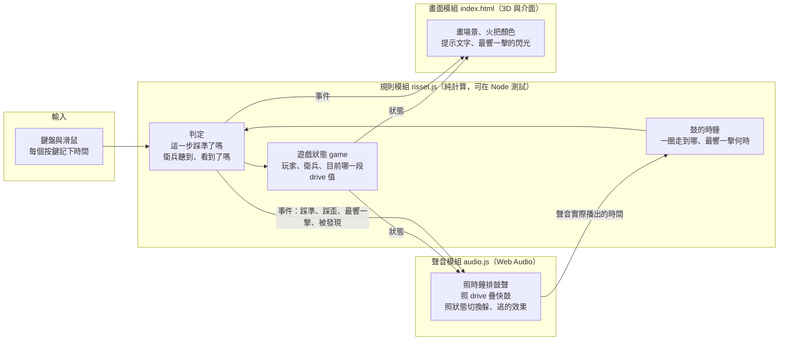
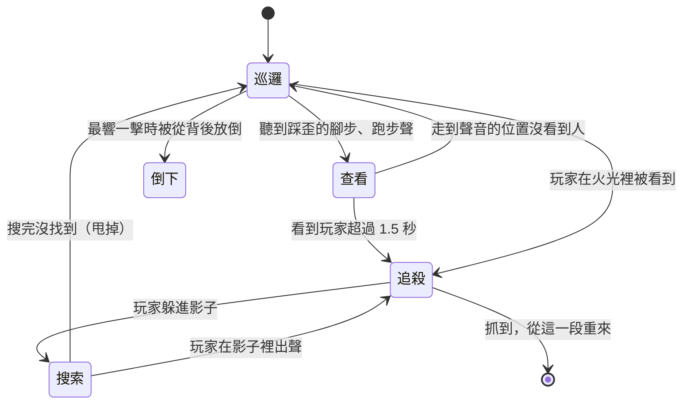

# 《木馬之夜》期末版企劃書（2026-11-15，設計席）

狀態：🟡 初稿，等試玩清單頁的四項結果（照亮場景整關、敲暗號、弓弦、空白鍵與 Alt）回來補第 4 節；其餘可以當第 12 週提案的底稿。2026-11-24 更新：第 8 節改單人時程，第 11 節不用試玩的三項已定案。
一句話結論：做一個 8～10 分鐘、七段的潛行關卡，玩家踩著鼓點從木馬走到城門；鼓聲從頭到尾越來越急（`DRIVE`），這一項確定進遊戲，只動聲音。
依據：`2026-11-12-free-hit-schedule.md` 第 13 節、`2026-11-11-companion-mechanics.md`、`2026-11-11-trojan-horse-directions.md`、`2026-11-15-hit-reveal-spec.md`、`docs/process/playtest-notes.md`（11/15 試聽）、`docs/process/status-board.md` 期末段。

專有詞（第一次出現都在這裡）：
- **踩拍**＝腳步落在鼓點上，腳步聲就被鼓聲蓋住，衛兵聽不到。
- **最響的一擊**＝所有鼓同時落下、特別重的那一下，之後 0.6 秒衛兵察覺不到你，可以衝刺、從背後放倒衛兵。
- **一圈**＝鼓聲從一次最響的一擊到下一次，遊戲裡大約 5～6.5 秒。
- **催促（`DRIVE`）**＝一個 0 到 1 的數字，越大，鼓聲上面疊的快鼓越多、越大聲；只影響聽起來多急，不影響哪幾拍踩得上。
- **查看**＝衛兵聽到怪聲，走過來看一下（火把變橘色）；退開或躲進影子就沒事。
- **追殺**＝衛兵看到你了（火把變紅），要跑、要躲進影子等他搜完。
- **關口**＝一段路上一定要通過、最考時機的那個點。
- **程式玩家**＝自動玩遊戲的程式，用來量通關率與時間。

---

## 1. 概念與核心循環

**一句話**：特洛伊城慶祝勝利的那一夜，你是從木馬肚子裡爬出來的奧德修斯；全城的祭典鼓聲是你唯一的掩護，踩著鼓點走到城門、把門打開。【經典】

**玩家每幾秒在做的事**

1. **聽**：找出鼓聲裡踩得上的低鼓，以及下一次最響的一擊什麼時候來。
2. **踩**：跟著低鼓走，腳步聲被蓋住；踩歪一步，衛兵就會過來查看。
3. **等那一擊**：最響的一擊落下的 0.6 秒裡做大動作，衝過火光、從背後放倒衛兵。
4. **越來越急**：鼓聲隨著你深入城裡越來越密、越來越快，逼你在更吵、更急的聲音裡找到同一條低鼓。

**特色（提案時講這三點）**
- 用耳朵玩的潛行：安全不安全是聽出來的。
- 鼓聲用「聽起來一直在加速」的節奏錯覺（Risset 節奏）做底，再加上真的越疊越快的鼓，整關是一條往上的緊張曲線。
- 經典故事，沒讀過也懂：木馬、夜裡、開城門。

## 2. 關卡流程（首次遊玩含重來 8～10 分鐘）

現行原型是四區（木馬腹中與木馬下、神殿廣場、窄巷、城門），程式玩家（中等準度）跑完約 45 秒；真人時間沒量過，第 13 週小組測試時量。下表的時長是目標，不是量到的數字。

| 段 | 名稱 | 目標時長 | 教什麼（每段只教一件新事） | 難度 | `DRIVE` 起→止 | 來源 |
|---|---|---|---|---|---|---|
| 序 | 木馬進城 | 0:30 | 不能操作。三張插圖加旁白：木馬被拖進城、全城慶祝、夜深 | — | 鼓聲隔著木板，悶 | 【經典】 |
| 1 | 木馬腹中 | 1:00 | 踩拍：在肚子裡踩準 4 步，暗門才開；不會失敗 | 0 | 0.30→0.35 | 【經典】＋【改編】 |
| 2 | 木馬下 | 0:40 | 最響的一擊：等那一擊落下，從木馬的影子走出去；一名衛兵 | 1 | 0.35→0.45 | 【改編】 |
| 3 | 神殿廣場 | 1:20 | 影子與查看：踩歪了衛兵會走過來，退開或躲進影子 | 2 | 0.45→0.60 | 【改編】 |
| 4 | 慶宴的街【新】 | 1:20 | 蹲與跑：開闊、矮掩體多，蹲著過矮牆、跑過沒人的空地 | 2 | 0.60→0.70 | 【經典】（特洛伊人慶祝到醉倒）＋【改編】 |
| 5 | 城牆下的窄巷（重排） | 1:10 | 從背後放倒衛兵、屏息 | 3 | 0.70→0.80 | 【改編】 |
| 6 | 沒有火的後街【新】 | 1:20 | 追殺與甩掉；整關最暗，靠最響的一擊照亮看路（照亮場景納入時） | 4 | 0.80→0.90 | 【改編】 |
| 7 | 城門 | 1:10 | 綜合；推門閂要挑時機 | 4 | 0.90→1.00 | 【經典】 |
| 終 | 城門開了 | 0:30 | 不能操作。一張插圖：城門打開、城外的火把 | — | 最後一擊後全靜 | 【經典】 |

合計 9:00。熟手不重來大約 5 分鐘（推測）。

**難度曲線的做法**
- 每段**只有一個關口**，其餘是可以喘氣的路。現行第 3 區窄巷的問題是整段都是關口：巷尾兩名衛兵交錯，被追殺後最難甩掉的就是這一段（量測與判讀見 `2026-11-11-companion-mechanics.md` 第 14～17 節）。
- 前兩段不會被追殺（腹中不會失敗；木馬下的衛兵只會查看）。追殺第一次出現在廣場，正式教在後街。
- 畫面提示照現有的輔助分區往後減少：第 1～4 段完整、第 5 段變淡、第 6～7 段沒有。

**窄巷重排（排關卡的規格，其他新區照同一套；11/24 起由自己用關卡編輯器排）**

| 項目 | 規定 | 理由 |
|---|---|---|
| 關口 | 每段一個，寬 3～4 公尺 | 整段都窄就沒有退路 |
| 影子 | 每段至少 3 塊，關口前後各一塊，最遠相隔不超過 10 公尺 | 被追殺時 3 秒內跑得到 |
| 矮掩體 | 新區各 3 個以上；窄巷補 2 個 | 蹲才有用處 |
| 衛兵 | 每段最多 3 名；同一個關口最多 1 名巡邏加 1 名站崗 | 兩名巡邏交錯目前沒人過得去 |
| 空地 | 每段一塊 8 公尺以上、沒有衛兵聽得到的路段 | 讓跑有用、讓玩家喘氣 |
| 存檔點 | 每段起點，起點在影子裡 | 重來不會一出生就被看到 |
| 大小 | 新區各約 15 × 30 公尺，全圖從 60 × 30 加長到約 90 × 30 | 一段要走 1 分多鐘；實際大小第 1 週（12/3 試玩）量過再調 |

交付：方格紙一格 1 公尺，標牆、矮掩體、影子、衛兵路線與面向、起點、出口。由程式抄成關卡資料。

## 3. `DRIVE` 進遊戲的裁決（原 13.4 第 3 步）

🟢 **進遊戲。** 依據是 11/15 試聽：H2（`DRIVE` 1）才夠快、H3 連續升有累積感、低鼓與最響的一擊在 H2 都聽得清。

| 項目 | 裁決 | 依據／備註 |
|---|---|---|
| 升法 | **連續升**，不分階 | H3 勝過 H4 |
| 範圍 | **0.30 到 1.00**。起點不放 0 | H1（0.5）還不夠快，從 0 起會有半關聽起來太慢。0.30 是假設，要聽 |
| 每段的值 | 第 2 節表格的「起→止」；在該段裡照經過的時間直線升，花該段目標時長的 1.5 倍升到「止」，到了就停 | 待在原地也會升，但有上限，不會在第 2 段就到頂 |
| 換段 | 進下一段時，若低於該段的「起」，4 秒內滑上去；不跳 | 不要聽到一階一階 |
| 追殺 | 2 秒內升到 1.00（沿用現有的逃跑加速）；甩掉後 4 秒內滑回追殺前的值 | 只有這裡和重來會往下 |
| 重來 | 回到該段的「起」 | 存檔點是每段起點 |
| 躲在影子裡 | 現有的悶住效果照樣疊上去 | 不改 |
| 誰算 | 規則檔新增純函式 `driveFor(段, 該段經過秒數, 是否追殺中, 追殺前的值)`，結果放 `game.drive`；**任何判定都不讀它**。聲音讀它決定快鼓的音量，畫面可以讀它做氣氛 | 放在規則檔才測得到；不讀它才不會改難度 |
| 第三步（把最響的一擊解開） | ⚪ 不進期末版 | 見下 |

> [!WARNING]
> 「速度上去後還聽不聽得出又從頭來了」使用者答「每個不一樣」，這題沒有結論。不擋 `DRIVE` 進遊戲；進遊戲後的第一次試玩補問一題：「第 6、7 段（最快的時候）聽不聽得出鼓聲在重來？」聽得出而且礙事，才重開第三步。
> 另外，長時間停在 1.00（每分鐘約 1100 拍的密鼓）耳朵會不會累，沒有人聽過超過 1 分鐘。所以只有城門和追殺會到頂。

**實作後的兩點確認（11/15，規則角色提出，2579825）**
- 🟢 甩掉追兵後滑回的是「沒被追殺時這一刻該有的值」，不是追殺前記下的值。追殺期間段內時間照走，所以會略高一點；這更符合只增不減，接受。上表「追殺」一列以此為準。
- 🟢 現有區和段的對應：開場→序、腹中→段 1、廣場→段 3、窄巷→段 5、城門→段 7。段 2「木馬下」現在沒有獨立的區，從腹中進廣場時靠 4 秒滑上去補，接受；第 13 週把七段做進遊戲時再拆出來。

**驗收（聲音角色做、量測角色驗）**
1. `DRIVE` 開關關掉時，聲音輸出和現在逐拍相同。
2. 全套測試與整關數字不變（規則沒有讀 `game.drive`）。
3. 任何 `DRIVE` 值下，踩得上的低鼓不小於最明顯那條鼓的 0.4 倍（現有檢查）。
4. `driveFor` 的 Node 測試：只增不減（追殺結束與重來除外）、換段不跳、追殺 2 秒到頂。
5. 試驗場：`?lab=drive`，畫面顯示目前的值，可以用按鍵直接設值與切換段。

## 4. 機制清單

**納入（期末版一定有）**

| 機制 | 現況 | 期末前要做的 |
|---|---|---|
| 踩拍走路 | 🟢 已做 | — |
| 最響的一擊（0.6 秒掩護） | 🟢 已做，±5 毫秒自動檢查 | — |
| 影子躲藏、查看、追殺與甩掉 | 🟢 已做 | 新區的搜索路線 |
| 跑與衝刺、蹲、屏息 | 🟢 已做；空白鍵立刻停、Alt 蹲 🔵 等清單頁 | 依試玩結果微調按鍵 |
| 從背後放倒衛兵、推門閂 | 🟢 已做 | — |
| 腹中練習（踩準 4 步開暗門） | 🟢 已做，在開關後面 | 改成預設開；要不要把校準併進來、分四步教，見 `2026-11-27-opening-and-tutorial.md`（等使用者選定） |
| `DRIVE` 鼓聲越來越急 | 🟢 試聽通過 | 進遊戲（第 3 節） |
| 提示與輔助分區 | 🟢 已做 | 配合七段重排 |
| 序與終的故事 | 文字字卡已做（`?story=1`） | 單人版不畫插圖，用黑底加文字旁白；有餘力才補圖 |

**看試玩結果決定（預設值寫在右欄，結果回來我補裁決）**

| 機制 | 試玩到哪 | 預設 |
|---|---|---|
| 最響的一擊照亮場景（`REVEAL_MODE`） | 試驗場：好玩、暗度可接受；🔵 整關版等清單頁 | **納入，但只在第 6 段後街**當那一段的主題；整關結果好再擴到全關 |
| 敲暗號 | 第一次試「不知道怎麼敲」；改過說明，🔵 重試中 | **只留在腹中**：出暗門前照同伴的示範敲一次，當儀式，不做成整關指揮同伴。重試還是不會敲就砍 |
| 弓弦聲 | 🔵 待試 | **不納入**。弓是後面復仇那一章的東西，期末版不需要它 |

**試上面兩項時一併套用的規則（2026-11-27，使用者選定；借自音樂花園 `SPEC.md` 1.3、1.4、1.8 節，只借規則、不搬程式）**

| 套在哪 | 規則 | 怎麼驗 |
|---|---|---|
| 敲暗號的教學 | 同伴示範前至少 1.2 秒先亮提示；一次示範只收玩家第一次敲的結果；同一場敲錯 2 次後，把正確的敲法淡淡顯示 1 秒，顯示不算過關，下一次仍要自己敲 | 第一次玩的人不看說明，3 次內敲對 |
| 最響的一擊照亮場景 | 全畫面亮度來回變化（相對亮度差 ≥ 10% 算一次）每秒最多 3 次；單一畫格平均亮度和前一秒平均的差 ≤ 20%；系統開了「減少動態」時改成不閃的固定亮度 | `DRIVE` 在最高值 1.00 時量亮度曲線，不超過上限；自動檢查加一項 |

**失敗與結尾的做法（2026-11-27，使用者選定；借自晚安小鎮 `晚安小鎮-設計規格.md` 第 2、3.4 節，只借規則、不搬程式）**

照下面的順序做，前一項做完才做下一項：

| 順序 | 項目 | 規則 | 怎麼驗 |
|---|---|---|---|
| 1 | 連續被抓就把提示叫回來 | 同一段連續被抓 2 次，這一段的畫面提示恢復成完整（第 5～7 段原本是變淡或沒有）；過了這一段就照原本的分區收掉。不改難度、不改衛兵 | 自動檢查：同段失敗 2 次後提示等級回到完整，換段後回到該段原本的等級 |
| 2 | 被抓後只講一件事 | 失敗畫面只顯示一句這次差在哪（例如「沒等最響的一擊就衝」），有多個原因時取最早發生的那一個；不列一整排 | 每種失敗原因各有一句，句子照 `docs/game-text.md` 的寫法 |
| 3 | 終章靜下來的細節 | 城門打開的那一擊之後，聲音分三層退掉（快鼓、低鼓、衛兵與環境聲），最後只留風聲；3 秒內不出字卡、不出按鈕 | 錄音量三層退掉的時間點；3 秒內畫面沒有新文字 |
| 4 | 「現在做不到」看得到 | 上面三項都做完才做。跑完在喘、屏息條用完時按了沒反應，改成看得到、聽得到的「現在做不到」。第一人稱看不到自己的手，演法要先想（候選：呼吸聲加重、畫面邊緣短暫收窄），動工前回設計席定 | 待定 |

**失敗畫面「下次怎麼做」怎麼呈現（2026-11-28 發想，設計席；🟡 等使用者選）**

現況（查過 `index.html` 的 `showOver`、`risset.js` 的暗示階梯）：失敗畫面第一行是原因（`g.failLine`，這次最早的失誤）。第二行 `#failHint` 不是每次都有，只在 8 秒內剛發過暗示階梯（同一種失誤連續失敗時逐級給提示的規則：第 1 次沒有文字、第 2 次一句做法、第 3 次再加按鍵）時才出現。兩個問題：一、兩行可能在講不同的事，原因取「最早的失誤」，做法取「最近發的提示」，例如原因是火光、做法卻在教屏息；二、和順序 2「只講一件事」不一致。

| 做法 | 玩家體驗 | 對上「用耳朵玩」 | 和提示漸少、提示叫回怎麼接 | 工作量 | 改回來的難度 |
|---|---|---|---|---|---|
| 甲 併成一句 | 永遠只有一行。原因句本身寫到看得出反面（「腳步沒落在鼓點上」），不另外教 | 普通：還是讀字，只是變少 | 做法完全交給重來後叫回的畫面提示；第 6～7 段第一次被抓時沒有任何做法 | 低，半天內：拿掉第二行，檢查 15 句原因 | 低 |
| 乙 分次給，而且講同一件事 | 第 1 次只有原因；同一種失誤第 2 次才多一行做法，第 3 次再加按鍵。第二行一定跟著原因那件事走 | 普通：文字，但第一次留給玩家自己聽出來 | 門檻和提示叫回同為 2 次：畫面提示回來的那一次，文字做法也才出現，玩家感覺是「卡住了才有人幫」 | 低，半天到 1 天：第二行改成照 `failCause` 取，加自動檢查 | 低 |
| 丙 重來後用聲音演一次 | 失敗畫面只有原因。重來後開頭約一小節，其他層鼓壓低、只突出低鼓，再放回來；屏息、門閂這類聽不出做法的，改成那個按鍵的提示先亮一下 | 最強：做法是聽到的，和開場「先單獨放低鼓、再把雜音加回來」同一招 | 聲音先、畫面晚一拍：第 1 次失敗只有聲音演，第 2 次畫面提示叫回；後段提示拿掉後，留下的還是聲音 | 中，1～2 天：聲音角色做壓低與放回，規則角色給「這次該演哪一種」 | 中低：放在開關後面 |
| 丁 失敗當下重播那兩秒 | 被抓後畫面暗下，重播被抓前 2 秒的鼓和自己的腳步，踩歪的那一步特別響，原因句在那一步出現 | 強：直接聽見自己錯在哪 | 不依賴提示等級；但只對「踩歪、跑、太響」有用，被看見或沒屏息的重播聽不出東西 | 高，2～3 天：要記下並重播聲音事件 | 中 |

**建議：乙現在做，丙排第 2 週（12/7～13）當加分項，甲、丁不做。**

- 乙解掉現在最實際的毛病（兩行講不同的事），而且不加新東西，只是把已有的兩套規則對齊：原因取哪件事，做法就講哪件事；門檻和提示叫回一樣是 2 次。
- 丙最合「用耳朵玩」，也和開場教學的建議是同一招，但要動聲音，12/3 前做不穩。做了丙，乙的第二行仍然留著當保底，因為屏息、門閂這類做法光聽是聽不出來的。
- 甲太省：後段第一次被抓時完全沒有做法，新手容易卡。丁最貴，而且一半的失敗原因用不上。
- 乙的規則補充：第一行原因不變；第二行出現時，放在原因下方、字比原因小一級；同一種失誤成功一次就收掉（照現有暗示階梯）。

等 12/3 自己試玩才能定的：
- 第 1 次失敗沒有做法，會不會卡住。會的話，改成第 1～4 段第 1 次就給做法、第 5 段起才等到第 2 次。
- 15 句原因是不是每句都看得出「下次該怎麼做」；看不出的要改句子。
- 丙的「只突出低鼓」聽不聽得出來，壓低多少、多久（先假設其他層降到約三成、維持一小節）。
- 提醒：自己試玩驗不到新手，丙要不要留，最好再找一個沒玩過的人被抓兩三次看反應。

建議總控問使用者的題目：

| # | 題目 | 選項（第一個是建議） |
|---|---|---|
| 1 | 失敗畫面的「下次怎麼做」怎麼呈現 | ① 第 1 次只給原因，同一種失誤第 2 次才加一行做法，而且兩行講同一件事（建議）；② 永遠只有原因一句，做法交給重來後的畫面提示；③ 維持現在兩行，只修成講同一件事 |
| 2 | 重來後用聲音演一次（開頭一小節只突出低鼓） | ① 排第 2 週（12/7～13），做不完就砍（建議）；② 12/24 前不做，留到寒假；③ 12/3 試玩完再決定 |

有餘力才做（不排進週表）：逃出城後出一張「這一夜怎麼走的」圖，踩準的步是點、趁最響的一擊衝出去的是線、被追的那段變亂；只在結束後出現，不搶耳朵。細節見 `concepts-overview.md` 第 4 節「音樂花園 × 木馬之夜」。

**不納入（寒假再說）**

| 機制 | 為什麼 |
|---|---|
| 第三步：最響的一擊不固定在一圈開頭 | 會改難度，要重量所有數字；`DRIVE` 夠用就不必做 |
| 整關一圈真的變短 | 同上 |
| 換層走路、一步一按 | 試玩結論是「只想在某些時候」，還沒有設計 |
| 離鼓越近越能動、自己補一拍 | 第二批想法，沒有原型 |
| 安撫 | 11/11 已拿掉，改成查看 |
| 手機版、電腦安裝版 | 使用者已定期末前只做網頁 |
| 地圖與方向指引 | 使用者 11/26 選「先不做」：12/3 自己試玩時記下有沒有迷路再決定。候選依序是七格進度條加城門火光指方向、按 M 叫出地圖；不做一直顯示的小地圖（會搶走耳朵的注意力，也跟提示漸少衝突） |

## 5. 操作表（電腦，鍵盤加滑鼠）

| 按鍵 | 動作 | 備註 |
|---|---|---|
| W A S D（或方向鍵） | 走 | 起步落在低鼓上才算踩準 |
| 滑鼠 | 轉頭 | 點畫面鎖定滑鼠，Esc 放開 |
| Shift 點一下 | 衝刺一小段 | 最響的一擊後才安全 |
| Shift 按住 | 跑 | 很吵，跑完會喘 |
| Alt 按住 | 蹲 | 慢、安靜、能躲在矮掩體後 |
| 空白鍵 按住 | 立刻停下、屏住呼吸 | 聽得到衛兵腳步在哪 |
| E | 從背後放倒衛兵；城門前按住推門閂 | |
| T | 敲暗號 | 只在腹中，納入時才有 |
| R | 失敗後從這一段重來 | |
| Esc | 暫停 | |

Q 原本是安撫，已拿掉，空著。手把與手機觸控期末版不做。

## 6. 聲音方向

- **鼓**：一種鼓、六層、每層快一倍，音量照鐘形分布（試聽 U1 版）。底下一條低而厚的鼓是踩得上的拍，上面是 `DRIVE` 疊上去的快鼓。
- **最響的一擊**：每圈一次，落下前有預告音。
- **四種狀態的聲音**：潛行（正常）、躲（悶住、小聲 10 分貝）、逃（2 秒內加速到最快、帶殘響）、甩掉（滑回原本的值）。
- **衛兵**：腳步、追殺時的喊聲；屏息時聽得到位置。
- **序與終**：序的鼓聲隔著木板；終在城門打開的那一擊之後全部靜下來，只留風聲。
- **不做**：旋律配樂。整關的音樂就是鼓。
- 🔵 還要用耳朵確認：起點 0.30 會不會太慢、在最高值待 1 分鐘累不累、最快時聽不聽得出重來。

## 7. 美術方向

| 部分 | 風格 | 誰做 |
|---|---|---|
| 序與終的故事插圖（4 張）、角色立繪、標題字、介面圖示 | **二次元畫風**，氣氛陰暗緊張；用色限三種：夜藍、火橘、警告紅 | 單人版只做標題畫面一張；海報不做（11/26）。序與終的插圖（B）列為加分項，時間夠才做，可先用 AI 假圖（11/24 改，原本交電繪同學） |
| 3D 遊戲畫面 | **暗色寫實**；光源只有火盆、火把。11/26 使用者選定加強（A）：調材質、火光、霧與陰影，讓衛兵、木馬、城門、關口這些關鍵物件一眼認得出；網頁版的效能要實測 | 自己 |
| 介面與標題（C） | 11/26 使用者選定加強：標題字、按鍵提示、介面圖示統一成同一套線條風格，只用三色色票 | 自己 |
| 兩者怎麼接 | 插圖的火橘與紅，和遊戲裡火把查看（橘）、追殺（紅）用同一組顏色；介面圖示用插圖的線條風格 | 一起定色票 |

**角色（名字加一個特徵稱號，沒讀過也記得住）**

| 稱呼 | 是誰 | 出現在 | 來源 |
|---|---|---|---|
| 多謀的奧德修斯 | 玩家 | 立繪、序 | 【經典】 |
| 腹中的同伴 | 木馬裡教你敲暗號、提醒別出聲的人；名字沿用木馬定稿文件 | 腹中的台詞、立繪 1 張 | 【改編】 |
| 舉火把的衛兵 | 特洛伊守夜人，不取名字 | 3D、插圖 | 【改編】 |

冷門人物不放進玩法；要放也只當一句台詞。畫面不出現現代的東西。

**提案要交的草圖**：風格草圖 2～3 張（電繪）、主視覺 1 張（電繪）、全城平面圖含新兩區（建築）、一張畫面截圖標出介面位置（程式）。

## 8. 單人時程與里程碑（2026-11-24 改：原三人分工作廢）

改單人的原因：老師要求期末專題一人一題（報告角色 11/23 記錄）。原本分給電繪同學與建築同學的工作，照下面三條處理：
- **平面圖**：不再另外畫。關卡已經資料化，直接用關卡編輯器（`prototypes/level-editor.html`）改，七段版 `?map=final` 就是定稿的底。
- **插圖與美術**：縮到最小。序與終用黑底加文字旁白（故事字卡，已做）；標題畫面一張；海報不做（使用者 11/26）。美術的力氣改放在 3D 場景和介面（使用者 11/26 選 A 加 C），插圖只當加分項。
- **試玩**：只有自己試玩，不找別人（使用者 11/26）；結果記在試玩清單頁，不另外做表。
- **開場動畫與教學**：新項目（使用者 11/26）。11/27 設計席分析完成，三個做法與建議見 `2026-11-27-opening-and-tutorial.md`，等使用者選定。序與終的故事仍維持黑底字卡（第 4 節），開場動畫是另外一件事。

日期：每週四上課（使用者 11/15 確認）：12/3、12/10、12/17 報進度（用同一份簡報），12/24 期末發表；**1/8 上傳最終版**（本科已確認）。

**六週分配（2026-11-28 改，使用者指定：從現在到 1/8 分成六週，不用學期週數）**。11/16～11/29 是準備期，已完成：`DRIVE` 進遊戲、關卡資料化、七段版 `?map=final`、短展示版 `?map=demo`、關卡編輯器、提案簡報（11/26）、3D 場景加強、介面統一試做（`?ui=2`）、離線化；開場第一批在 11/29～30 週末做。

前提：這張表以「定題為木馬之夜、做電腦版（鍵盤加滑鼠）」寫的；題目若改，這一節要重寫。

| 週 | 日期 | 要做的事 | 這一週結束要看得到的東西 |
|---|---|---|---|
| 第 1 週 | 11/30～12/6，**進度 12/3** | 用新開場自己整關試玩七段版：量每段時間、記卡關處、記有沒有迷路；定 `DRIVE` 各段的值；接上「連續被抓提示回來」「失敗只講一句」 | 試玩紀錄（自動摘要）與第 4 節三項裁決 |
| 第 2 週 | 12/7～13，**進度 12/10** | 照試玩結果改難度與提示；開場第二批（只剩低鼓、踩歪的後果）；終章三層退聲；木馬進城鏡頭動畫（`intro=cam`）；介面風格定案 | 改過、開場完整的版本 |
| 第 3 週 | 12/14～20，**進度 12/17** | 只修錯，不加東西；錄示範影片；簡報定稿（時程頁一起改） | 可以發表的版本 |
| 第 4 週 | 12/21～27，**發表 12/24** | 發表、現場示範（用短展示版，七段版備用）；記下老師與同學的回饋 | 發表回饋清單 |
| 第 5 週 | 12/28～1/3 | 照發表回饋改；「現在做不到」看得到（第 4 節順序 4，演法先回設計席定）；有餘力才做的項目（「這一夜怎麼走的」結束圖、地圖、插圖）挑做 | 最終版候選 |
| 第 6 週 | 1/4～1/8，**1/8 上傳** | 只修錯；整理製作紀錄與說明；上傳最終版 | 最終版 |

一個人做不完時，照第 10 節的順序砍，不壓縮試玩那一週。

## 9. 程式流程

程式分三個模組，規則不知道聲音和畫面的存在，所以換畫面或換平台不用重寫規則。

- **時間以聲音為準**：鼓聲由瀏覽器的聲音系統精準排程，規則的時鐘跟著它走；按鍵的時間先扣掉聲音輸出的延遲再判定，所以聽到的拍和判定的拍是同一拍。
- **測試**：規則有 Node 測試與程式玩家（量通關率、時間）；聲音有自動檢查（最響的一擊誤差 ±5 毫秒內）；每個機制有自己的試驗場（網址參數開啟）。

**衛兵的狀態（玩家要對付的就是這張圖）**

## 10. 風險與砍範圍的順序

| 風險 | 多可能 | 對策 |
|---|---|---|
| 整關玩不到 8 分鐘（關卡太短或太簡單） | 中 | 第 1 週（12/3）自己試玩量；只有自己試玩，熟悉關卡會偏快，量到的時間要往上估；不夠就把後街加長，不加新機制 |
| `DRIVE` 進遊戲後還是沒有加速感 | 低到中（試聽頁通過，遊戲裡沒聽過） | 第 11 週就做進去，使用者第一時間聽；不行再把起點與每段的值拉開 |
| 新兩區做不完 | 中 | 照下面的順序砍 |
| 3D 場景加強後網頁跑不動 | 低到中 | 第 2 週邊調邊看幀數，效果分開關；跑不動就關掉霧和陰影，保留材質與關鍵物件的辨識 |
| 美術圖來不及或風格接不上 | 中 | 第 11 週先定色票與尺寸清單；插圖沒到就用文字旁白加黑底 |
| 單人做不完（11/23 起改一人一題） | 中 | 美術縮到標題畫面一張（海報不做），序與終用文字旁白；其餘照下面的順序砍 |
| 喇叭聽不清低鼓 | 已知 | 開場寫「請戴耳機」，輔助分區的畫面提示留著 |

**時間不夠時，從上往下砍，砍到哪算哪**

1. 弓弦聲、第二批想法（本來就不做）。
2. 敲暗號（腹中只留踩 4 步）。
3. 照亮場景（後街改成一般的暗區）。
4. 新區的第二個：後街。追殺教學移到窄巷。
5. 角色立繪、序與終插圖（B）等加分美術；3D 場景加強只留「關鍵物件好認」，材質、霧、陰影砍掉；介面統一只留按鍵提示。
6. 新區的第一個：慶宴的街。蹲與跑的教學併入廣場。這時是「現有四區重排加序與終」，約 5 分鐘。
7. **不能砍**：`DRIVE`、窄巷重排、序與終的故事字卡、每段一個關口。這四樣是期末版和期中版的差別。

## 11. 還沒定、要使用者決定的事

**不用試玩就能定的，2026-11-24 已定案**（使用者 11/24 交辦「做完不用試玩就能決定的那些」，由設計席裁決；不同意隨時可改）：

- ✅ 新兩區的主題定為「慶宴的街」與「沒有火的後街」【改編】。理由：兩區一亮一暗、一吵一靜，剛好對上蹲與跑的教學和追殺的教學；七段版 `?map=final` 已照這兩個主題做好，程式玩家通過率 98.5%，換主題要重排關卡卻換不到新玩法。
- ✅ 日期：提案 11/26、發表 12/24（使用者 11/15 確認）、1/8 上傳最終版；時程照第 8 節六週分配（11/28 起）。
- ✅ 組別：改單人，三人分工作廢，第 8 節已改成單人時程。

**要等試玩才能定的**，結果回來後一次整理成選擇題：

- 🔵 照亮場景：只在後街，還是全關？（看整關試玩）
- 🔵 敲暗號：留在腹中當儀式，還是砍？（看重試）
- 🔵 弓弦聲要不要納入（預設不納入）。
- 🟡 `DRIVE` 起點 0.30 與每段的值，進遊戲聽過後調；最快時聽不聽得出鼓聲在重來。

**不屬於設計席、但會影響這份文件的**：期末題目是不是木馬之夜、做電腦版還是手機版。第 8 節先以「木馬之夜、電腦版」寫。
